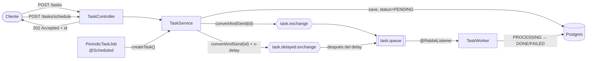

# Async Task Processor

Proyecto de aprendizaje: una API que recibe tareas pesadas, las encola y las procesa con workers en background, con reintentos, prioridades, tareas programadas y manejo de errores.

**Stack:** Spring Boot 3.5, Java 21, PostgreSQL, RabbitMQ, Docker Compose.

## Por qué

`POST /tasks` no debería hacer esperar al cliente mientras se procesa el trabajo pesado. La API valida, persiste la tarea con estado `PENDING` y responde `202 Accepted` con un id — el procesamiento real lo hace un worker asincrono que consume de una cola.

## Arquitectura actual



El mensaje de la cola lleva solo el `id` de la tarea, no el payload — el payload pesado vive en Postgres. Mensajes livianos y estado siempre consultable aunque el worker esté caído.

Reintentos con backoff exponencial vía TTL + Dead Letter Exchange: si el worker falla, el mensaje va a `task.retry` con un TTL creciente (`2^intentos * 10s`); al expirar, vuelve a `task.queue` para reintentarse. Agotados los reintentos, la tarea pasa a `FAILED` (con el error guardado) y el mensaje se publica en `task.dlq`. `GET /tasks/failed` lista las tareas en ese estado.

Colas de prioridad: `task.queue` declarada con `x-max-priority=10`. `POST /tasks` acepta un campo opcional `priority` (0-10, default 0 si no se manda) que se setea en el mensaje vía `MessagePostProcessor` al publicar. Con varios mensajes esperando en la cola, RabbitMQ entrega primero los de mayor prioridad — no reordena mensajes ya entregados ni afecta tareas que llegan cuando la cola está vacía.

Tareas programadas: `POST /tasks/schedule` recibe `{ type, payload, scheduleFor }` con un timestamp ISO-8601 en el futuro, persiste la tarea `PENDING` con `scheduleFor` y publica el id en `task.delayed.exchange`. Ese exchange es de tipo `x-delayed-message` (con `x-delayed-type=direct`) y retiene el mensaje con el header `x-delay` en milisegundos; recién al expirar lo rutea a `task.queue` como un mensaje normal. `task.queue` queda bindeada a los dos exchanges con la misma routing key. Si `scheduleFor` ya pasó o supera `X_DELAY_MAX` (~49,7 días), la API responde `400`.

Además, `PeriodicTaskJob` corre con `@Scheduled` y encola una tarea `type=periodic` llamando al mismo `TaskService.createTask`. El cron se configura con `task.periodic.cron` (default cada 5 minutos; en dev está cada minuto). Es un scheduler en proceso: si la app está apagada, el tick se pierde.

## Cómo levantarlo

```bash
docker compose up -d       # Postgres (host:5433) + RabbitMQ
./mvnw spring-boot:run      # API en http://localhost:8080
```

RabbitMQ management UI: http://localhost:15672 (`guest`/`guest`)

Postgres se publica en el puerto **5433** para no chocar con un PostgreSQL local en 5432. Desde el host se conecta con `psql -h localhost -p 5433 -U taskuser -d taskdb` (password `taskpass`).

```bash
curl -X POST http://localhost:8080/tasks \
  -H "Content-Type: application/json" \
  -d '{"type": "demo", "payload": "hello", "priority": 8}'
```

Programar una tarea para dentro de un minuto:

```bash
curl -X POST http://localhost:8080/tasks/schedule \
  -H "Content-Type: application/json" \
  -d "{\"type\": \"demo\", \"payload\": \"scheduled\", \"scheduleFor\": \"$(date -u -d '+1 minute' '+%Y-%m-%dT%H:%M:%SZ')\"}"
```

## Estado

Proyecto en curso, construido objetivo por objetivo:

- [x] **Objetivo 1** — API que encola tareas
- [x] **Objetivo 2** — Worker que consume y procesa
- [x] **Objetivo 3** — Reintentos con backoff exponencial
- [x] **Objetivo 4** — Dead Letter Queue
- [x] **Objetivo 5** — Colas de prioridad *(implementado, confirmando en vivo)*
- [x] **Objetivo 6** — Tareas programadas *(delayed exchange + job `@Scheduled`)*
- [ ] **Objetivo 7** — Endpoint de consulta de estado
- [ ] **Objetivo 8** — Dockerizar todo el sistema (API + worker + broker)
- [ ] **Objetivo 9** — Escalar workers + idempotencia
